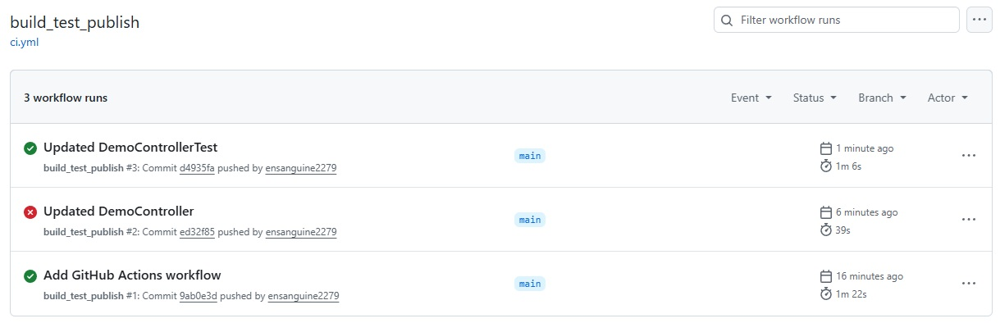
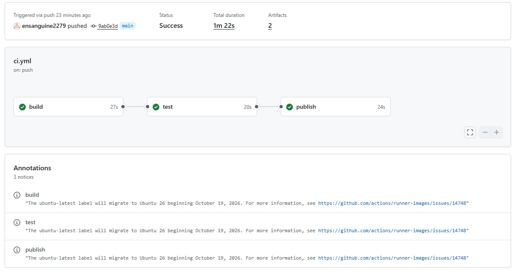
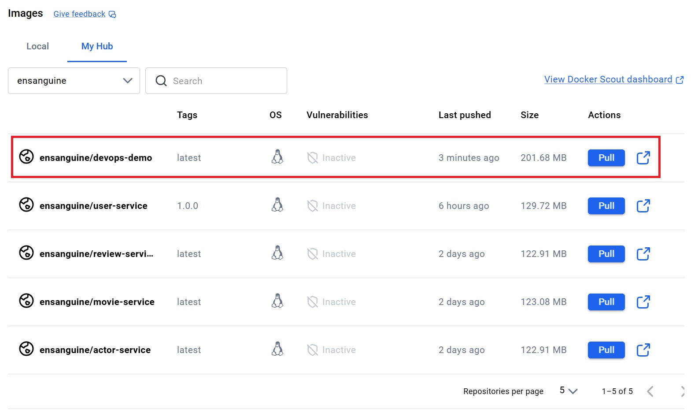
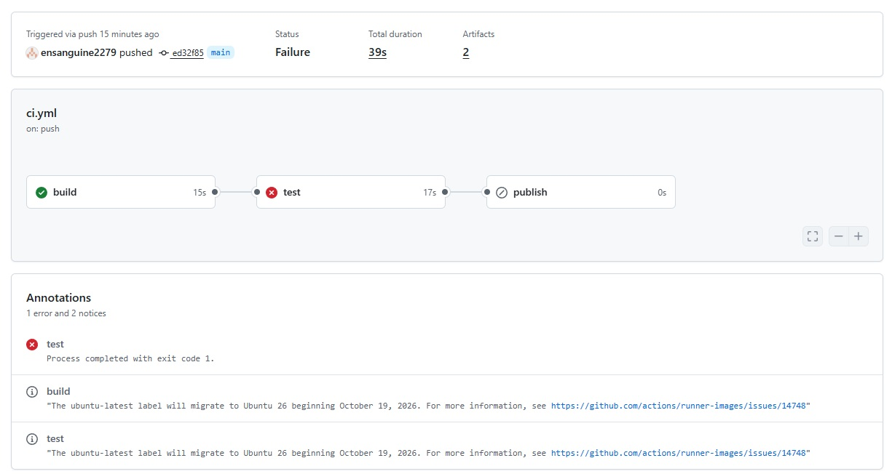
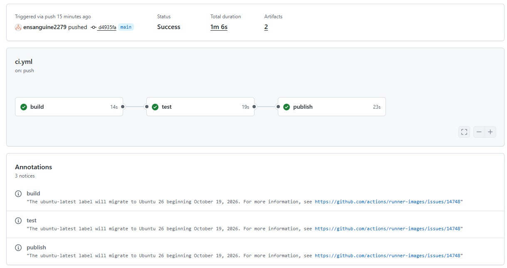

Completed devops-demo app for [Lesson 4.9: Tool Exploration - CI/CD Tools](https://github.com/su-ntu-sctp/ai-4.9-Tool-Exploration/blob/main/lesson.md)

### Attempted workflows in GitHub Action



### Initial Workflow



### Image published to Docker Hub



### Failed Workflow (after changing `DemoController.java`)



A mismatch of response content (due to change in `DemoController.java`) causes the test to fail.

```bash
-------------------------------------------------------------------------------
Test set: com.example.devopsdemo.controller.DemoControllerTest
-------------------------------------------------------------------------------
Tests run: 1, Failures: 1, Errors: 0, Skipped: 0, Time elapsed: 0.311 s <<< FAILURE! -- in com.example.devopsdemo.controller.DemoControllerTest
com.example.devopsdemo.controller.DemoControllerTest.testHelloEndpoint -- Time elapsed: 0.054 s <<< FAILURE!
java.lang.AssertionError: Response content expected:<DevOps demo application is running!> but was:<DevOps demo - GitHub Actions is working!>
	at org.springframework.test.util.AssertionErrors.fail(AssertionErrors.java:62)
	at org.springframework.test.util.AssertionErrors.assertEquals(AssertionErrors.java:129)
	at org.springframework.test.web.servlet.result.ContentResultMatchers.lambda$string$1(ContentResultMatchers.java:148)
	at org.springframework.test.web.servlet.MockMvc$1.andExpect(MockMvc.java:212)
	at com.example.devopsdemo.controller.DemoControllerTest.testHelloEndpoint(DemoControllerTest.java:30)
```


### Successful Workflow (after changing test case in `DemoControllerTest.java`)


